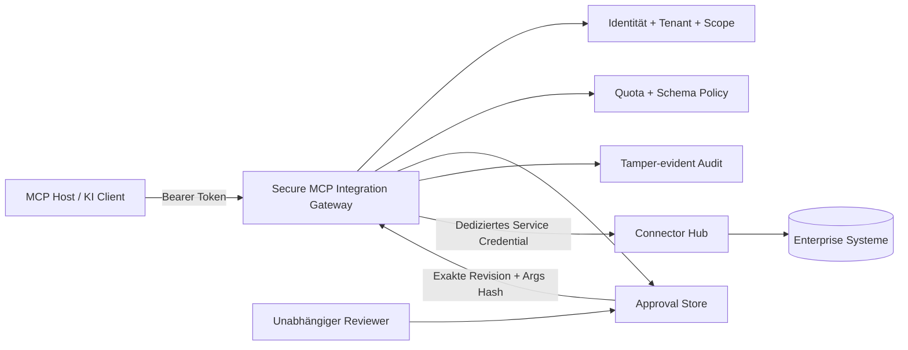

# Secure MCP Integration Gateway

> Eine Security-Grenze zwischen KI/MCP-Clients und Unternehmensintegrationen - mit identitätsbasierter Mandantentrennung, Least-Privilege-Tools, exakter Freigabebindung, Quoten, manipulationsnachweisbarem Audit und strikter Credential-Trennung.

**Release:** `1.0.0-rc.1` · **Java:** 21+ · **Protokollziel:** MCP `2026-07-28` als verifizierter Teilumfang · **Status:** Portfolio Release Candidate

[English](README.md) · [Start](START-HERE.md) · [Architektur](docs/de/architecture.md) · [Security](docs/de/security.md) · [Angriffsmatrix](docs/de/attack-matrix.md) · [Connector-Hub-Integration](docs/de/connector-hub-integration.md)

## Das Problem

Ein KI-Host darf keinen ungefilterten Zugang zu einer Enterprise-Integrationsschicht erhalten. Ein Modell darf weder einen Mandanten wählen noch Ziele erfinden, Caller-Tokens an andere Resource Server weiterreichen, beliebiges SQL ausführen oder eine alte Freigabe für einen veränderten Schreibvorgang wiederverwenden.

Dieses Projekt setzt deshalb einen bewusst kleinen MCP-Security-Adapter vor Connector Hub. Connector Hub bleibt die Provider-Ausführungsengine; das Gateway entscheidet **welche Provider-Fähigkeit sichtbar ist, für welche Identität und welchen Mandanten, unter welcher Revision, mit welchen Argumenten, welcher Rate und ob eine unabhängige Freigabe notwendig ist**.



## Vier bewusst kleine Tools

| Tool | Scope | Operation | Freigabe |
|---|---|---|---|
| `orders.lookup` | `orders:read` | Mandantengebundene Bestellung lesen | Nein |
| `inventory.check` | `inventory:read` | Mandantengebundenen Bestand lesen | Nein |
| `customer.documents.list` | `documents:read` | Bereits erlaubte Kundendokumente listen | Nein |
| `orders.cancel` | `orders:cancel` | Konsequenter Schreibvorgang | **Unabhängige Freigabe** |

Es gibt absichtlich **kein generisches HTTP-Tool, kein beliebiges SQL, kein vom Modell kontrolliertes Ziel, kein Tenant-Argument und kein Credential-Argument**.

## Warum der Schreibpfad wirklich gebunden ist

Ein Cancel-Aufruf ohne Approval-ID erzeugt eine ausstehende Freigabe und führt **keinen Write** aus. Die Freigabe ist gebunden an Tenant, Requester, Toolname, unveränderliche Tool-Revision, SHA-256-Fingerprint der kanonischen Business-Argumente, Ablaufzeit sowie Reviewer und Begründung.

Eine Änderung an Bestellung, Begründung, Requester, Tenant oder Tool-Revision macht die Freigabe unbrauchbar. Self-Approval und Cross-Tenant-Review werden abgelehnt. Die Approval-ID dient als Idempotency-Key für den Upstream-Aufruf.

## Nachgewiesene Security-Grenzen

- Token-Issuer, Ablaufzeit und **Audience** werden validiert.
- Tenant stammt aus dem verifizierten Security Context, niemals aus Modellargumenten.
- `tools/list` ist scope-gefiltert; die Berechtigung wird beim Call erneut geprüft.
- Geschlossene Tool-Schemas blockieren unbekannte Felder wie `url`, `sql`, `tenant` und Credentials.
- Moderne MCP-Metadaten und Standard-Header werden für den implementierten Teilumfang abgeglichen.
- OAuth Protected Resource Metadata wird bereitgestellt und in Authentication-Challenges referenziert.
- Caller-Bearer-Tokens werden niemals an Connector Hub weitergereicht.
- Connector Hub erhält ein separates Service Credential und feste Provider-Pfade.
- Unsichere Upstream-URIs werden abgelehnt; externe Hosts benötigen HTTPS und eine explizite Allowlist.
- Quoten gelten pro Principal und Tool.
- Audit-Einträge bilden eine SHA-256-Hash-Kette und speichern keine rohen Business-Argumente.
- Die Reviewer-Konsole verwendet strikte CSP, sichere DOM-APIs und keine Token-Persistenz im Browser.

## MCP `2026-07-28` Grenze

Implementiert ist bewusst nur der benötigte moderne Teilumfang: `server/discover`, `tools/list`, `tools/call`, per-request `_meta`, moderne MCP-Header-Konsistenz, aktuelle `resultType`/`ttlMs`/`cacheScope`-Felder sowie Protected Resource Metadata. `tools/list` verwendet `private` Cache Scope, da die Tool-Sichtbarkeit von der Authorization Context abhängt.

Diese Version behauptet **keine vollständige MCP-Konformität**. Legacy-Initialisierung, Prompts, Resources, Tasks, Subscriptions, Streaming/SSE, DCR und ein vollständiger Authorization Server liegen bewusst außerhalb des Scopes. Ein manueller GitHub-Workflow mit dem offiziellen stabilen MCP TypeScript v2 Client ist als separates Interoperabilitäts-Gate enthalten.

## Lokal starten

Voraussetzungen: **JDK 21+** und **Python 3.10+**.

```bash
python scripts/run_demo.py
```

Demo: `http://127.0.0.1:8096` · Reviewer-Konsole: `http://127.0.0.1:8096/admin`.

Temporäre Demo-Tokens werden unter `.local/access.json` geschrieben. `.local/` ist gitignored und darf nicht veröffentlicht werden.

## Reviewer-Konsole - Vorschau


*Illustrativer gefüllter Zustand mit synthetischen Demo-Werten; die Live-Konsole verwendet dasselbe ausgelieferte Layout/Styling.*

## Verifizierte Tests

```bash
python scripts/test.py
```

| Ebene | Verifizierte Checks |
|---|---:|
| Java Security-/Contract-Assertions | **26** |
| Live HTTP/MCP-Angriffsszenarien | **40** |
| Repository-/Release-Integrity-Checks | **11** |
| **Gesamt** | **77** |

Alle 77 deterministischen Checks liefen in der Authoring-Umgebung erfolgreich. Die exakte Ausgabe steht in [`docs/evidence/test-run.txt`](docs/evidence/test-run.txt).

Native Browser Acceptance und der offizielle MCP-v2-SDK-Test sind getrennte manuelle Release-Gates. Die Authoring-Umgebung blockiert native Browser-Navigation und der offizielle npm-SDK-Gate wurde dort nicht ausgeführt; beides wird daher nicht als bestanden ausgegeben.

## Recruiter-Demo

1. ACME liest `ORD-A100`.
2. `ORD-B200` eines anderen Tenants ergibt nur `not_found`.
3. `sql.execute`, URL-Injection, Tenant-Injection und ungültige Identifier werden abgelehnt.
4. `orders.cancel` erzeugt nur eine Freigabe, keinen Write.
5. Self-Approval und Cross-Tenant-Review schlagen fehl.
6. Ein unabhängiger Reviewer genehmigt die exakte Aktion.
7. Ein Zeichen in der Begründung wird geändert: die Freigabebindung blockiert die Ausführung.
8. Der exakte freigegebene Call wird ausgeführt und idempotent wiederholt.
9. Zum Schluss wird die Audit-Hash-Kette geprüft.

Kernaussage: **Das Modell darf zwischen erlaubten Tools wählen, aber keine Identität, keinen Tenant, kein Ziel und keine Business-Autorität erfinden.**

## Connector Hub

Das Gateway bleibt ein **Sidecar/Security-Adapter**. Vier feste, versionierte Connector-Hub-Publikationen werden auf die vier MCP-Tools gemappt. Ohne konfigurierte Connector-Hub-URL arbeitet die Demo mit deterministischen synthetischen Daten.

Details: [`docs/de/connector-hub-integration.md`](docs/de/connector-hub-integration.md).

## Produktionsgrenze

Der eingebaute HS256-Verifier, In-Memory Approval/Audit/Quota-State und das Demo-Backend sind nur für eine kompakte, ausführbare Referenz gedacht. Produktion benötigt OIDC/OAuth + vertrauenswürdiges JWKS, TLS, durable Shared State, verteilte Quoten, Key Rotation, Observability, Egress-Kontrolle, Backup/Restore und unabhängigen Security Review.

Dieses Repository zeigt Engineering Controls; es ist **keine Compliance-Zertifizierung und keine Produktions-Sicherheitsgarantie**.

## Lizenz

MIT. Siehe [LICENSE](LICENSE).
