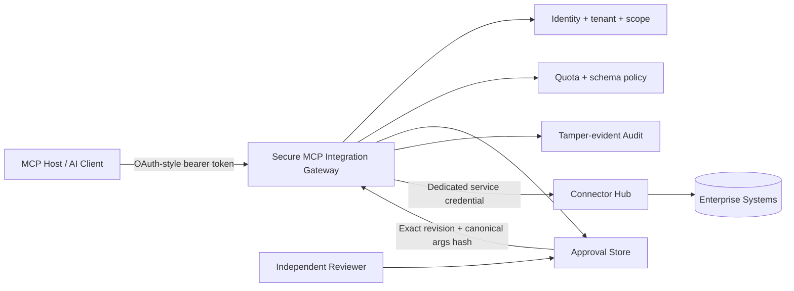
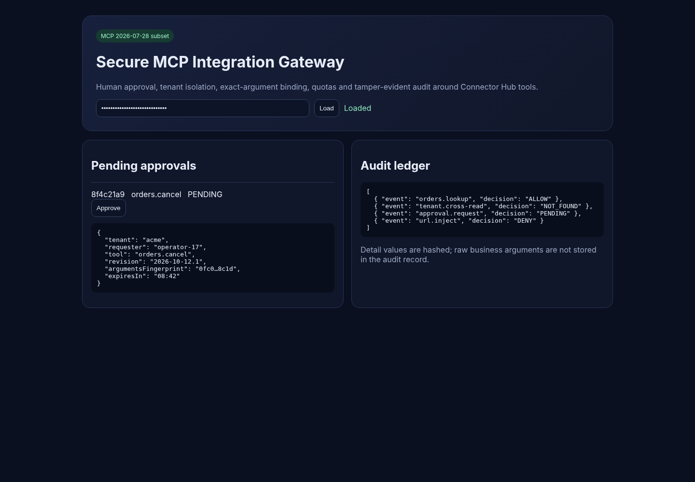

# Secure MCP Integration Gateway

> A security boundary between AI/MCP clients and enterprise integrations - with identity-derived tenancy, least-privilege tools, exact approval binding, quotas, tamper-evident audit, and strict credential separation.

**Release:** `1.0.0-rc.1` · **Java:** 21+ · **Protocol target:** MCP `2026-07-28` verified subset · **Status:** portfolio release candidate

[Deutsch](README.de.md) · [Start here](START-HERE.md) · [Architecture](docs/en/architecture.md) · [Security](docs/en/security.md) · [Attack matrix](docs/en/attack-matrix.md) · [Connector Hub integration](docs/en/connector-hub-integration.md)

## The problem

Giving an AI host a raw route into an enterprise integration layer creates a dangerous authority jump. A model must not be able to choose a tenant, invent a destination, forward a caller token to another resource server, execute arbitrary SQL, or reinterpret an old approval as permission for a different write.

This project adds a deliberately narrow MCP-facing security adapter in front of Connector Hub. Connector Hub remains the provider execution engine; the gateway decides **which provider-backed capability is visible, to whom, for which tenant, under which revision, with which arguments, at which rate, and whether independent approval is required**.



## Four deliberately small tools

| Tool | Required scope | Operation | Approval |
|---|---|---|---|
| `orders.lookup` | `orders:read` | Read one tenant-scoped order | No |
| `inventory.check` | `inventory:read` | Read tenant-scoped stock | No |
| `customer.documents.list` | `documents:read` | List already-permitted customer documents | No |
| `orders.cancel` | `orders:cancel` | Consequential write | **Independent approval** |

There is intentionally **no generic HTTP tool, arbitrary SQL executor, user-controlled destination, tenant argument, or credential argument**.

## What makes the write path governed

A cancellation request without an approval ID creates a pending approval and performs **no write**. The approval is bound to:

- authenticated tenant;
- original requester subject;
- tool name;
- immutable tool revision;
- SHA-256 fingerprint of canonical business arguments;
- expiration time;
- independent reviewer and review reason.

Changing the order, reason, requester, tenant or tool revision makes the approval unusable. Self-approval and cross-tenant review are denied. Execution uses the approval identifier as the upstream idempotency key, so a lost response can be retried without intentionally creating a second logical effect.

## Security boundaries demonstrated

- Validates token issuer, expiration and **audience** before protected operations.
- Derives tenant from the verified security context, never from model-controlled arguments.
- Scope-filters `tools/list` and rechecks authorization at call time.
- Validates closed tool schemas and rejects unknown fields such as `url`, `sql`, `tenant` and credentials.
- Cross-checks modern MCP protocol metadata and standard method/name headers for the implemented subset.
- Publishes OAuth protected-resource metadata and advertises it on authentication challenges.
- Never passes the caller bearer token into Connector Hub.
- Uses a dedicated upstream credential and fixed provider paths.
- Rejects unsafe upstream URI forms; non-loopback Connector Hub hosts require HTTPS and an explicit host allowlist.
- Enforces per-principal/per-tool quotas.
- Stores audit evidence in a SHA-256 hash chain without raw business arguments.
- Reviewer console uses a strict CSP, safe DOM APIs and no browser token persistence.

## MCP `2026-07-28` boundary

The implemented modern subset is intentionally small:

- `server/discover`;
- `tools/list`;
- `tools/call`;
- per-request `_meta` protocol/client information;
- modern `MCP-Protocol-Version`, `Mcp-Method` and `Mcp-Name` consistency checks;
- current `resultType`, `ttlMs` and `cacheScope` result fields;
- RFC 9728-style protected-resource metadata endpoint and bearer challenge metadata.

`tools/list` is marked `private` cache scope because tool visibility depends on the caller's authorization context.

This release **does not claim full MCP conformance**. Legacy initialization, prompts, resources, tasks, subscriptions, streaming/SSE behavior, DCR and a complete authorization-server implementation are deliberately outside scope. A manual workflow using the official stable MCP TypeScript v2 client is included as a separate interoperability release gate.

## Run locally

Requirements: **JDK 21+** and **Python 3.10+**.

```bash
python scripts/run_demo.py
```

The demo binds to loopback at:

```text
http://127.0.0.1:8096
```

Temporary demo tokens are written to `.local/access.json`. `.local/` is gitignored; never publish that file.

Reviewer console:

```text
http://127.0.0.1:8096/admin
```

## Reviewer console preview



*Illustrative populated state using synthetic demo values; the live console uses the same shipped layout/styles.*

## Verified tests

Run the release-gating local suite:

```bash
python scripts/test.py
```

The recorded release-candidate evidence currently contains:

| Layer | Verified checks |
|---|---:|
| Java security/contract assertions | **26** |
| Live HTTP/MCP attack scenarios | **40** |
| Repository/release-integrity checks | **11** |
| **Total deterministic checks** | **77** |

All 77 passed in the authoring environment. Exact output is captured in [`docs/evidence/test-run.txt`](docs/evidence/test-run.txt).

Two additional acceptance suites are intentionally separate:

```bash
python -m pip install -r requirements-browser.txt
python -m playwright install chromium
python scripts/test.py --browser
```

and the manual GitHub workflow **Optional official MCP v2 acceptance**. Native browser navigation is restricted in the authoring environment, and npm access for the official SDK gate was not used there, so neither is falsely reported as locally passed.

## Attack demonstration

The most useful recruiter demo is a short denial-first sequence:

1. ACME can read `ORD-A100`.
2. The same identity receives generic `not_found` for another tenant's `ORD-B200`.
3. `sql.execute`, a `url` argument, tenant injection and malformed identifiers are rejected.
4. `orders.cancel` returns an approval request and makes no write.
5. Self-approval and cross-tenant review fail.
6. A separate same-tenant reviewer approves the exact proposal.
7. Modify one character in the reason: execution is denied because the canonical argument fingerprint changed.
8. Execute the exact approved call and retry it: the same logical receipt is returned.
9. Verify the audit hash chain and show that raw business arguments are not stored there.

The story is simple: **the model may choose among authorized tools; it cannot manufacture identity, tenant, destination, approval or business authority.**

## Connector Hub integration

The repository is a **sidecar/security adapter**, not a Connector Hub rewrite. Configure fixed relative paths for four immutable published providers and a dedicated service credential. If no Connector Hub URL is configured, deterministic synthetic data keeps the portfolio demo self-contained.

See [`docs/en/connector-hub-integration.md`](docs/en/connector-hub-integration.md) and [`integration/connector-hub/`](integration/connector-hub/).

## Production boundary

The built-in HS256 verifier, in-memory approvals/audit/quotas and synthetic backend exist only to keep the reference implementation small and executable. A real deployment must replace them with OIDC/OAuth + trusted JWKS, TLS, durable shared state, distributed quota enforcement, key rotation, observability, restricted egress, backup/restore and independent security review.

This repository demonstrates engineering controls. It is **not** a compliance certification or a production security guarantee.

## License

MIT. See [LICENSE](LICENSE).
